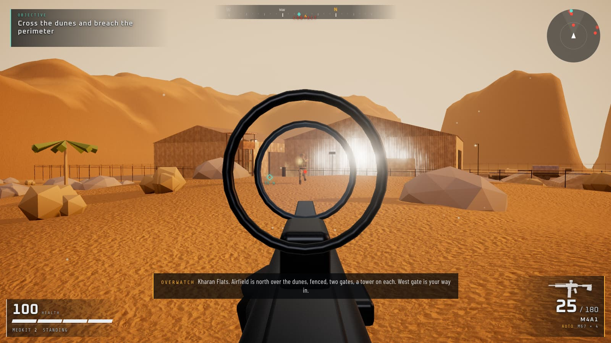

# CORDITE

**A lightweight single-player tactical shooter.** Six chapters with a spoken story, 460 real-world weapons that sound like the real thing, soldiers with human voices, and a game that weighs about 10 MB.

[**Website and downloads**](https://bassman8k.github.io/cordite/) · [**Play in the browser**](https://bassman8k.github.io/cordite/play/) · [**Latest release**](https://github.com/Bassman8K/cordite/releases/latest) · [**Report a bug**](https://github.com/Bassman8K/cordite/issues/new/choose)



## What it is

A private army has stolen LANTERN, a package that turns any guided weapon against whoever launched it. You are KESTREL, and you go in with two others, Merlin and Shrike, or alone if you prefer.

- **A campaign in six chapters.** A night harbour in the rain, a ruined boulevard, a mountain pass in a blizzard, a desert airfield, an underground lab and a coastal fortress. Each chapter is split into objectives with a checkpoint at every one, and you can start from any chapter you have reached.
- **460 weapons and counting.** Pistols, submachine guns, assault and battle rifles, sniper and anti-materiel rifles, historic rifles, shotguns, machine guns, launchers, blades and throwables. Each is entered by its real specifications (calibre, muzzle velocity, weight, barrel length, rate of fire, feed), and the game derives recoil, handling, drop and damage from those numbers.
- **Simulated ballistics.** Every round is a projectile with travel time, drag, gravity and penetration.
- **Enemies that fight back.** They patrol, investigate noise, take cover, flank, suppress and call for help, out loud: two recorded voice actors shout "Target engaged", "Reloading", "Fire in the hole" and "Medic", and a squad keeps talking for as long as the fight lasts.
- **A squad at your shoulder.** Merlin and Shrike follow your lead, hold their fire until the shooting starts, then fight beside you and draw their share of the enemy's. They cannot be killed. Turn them off in Settings to go in alone.
- **Weapons that sound like themselves.** Gunfire is cut from recordings of the real weapons, one set per cartridge: a Glock, a 1911, an M4, an AK-47, a SCAR-H, an M1 Garand, a Mosin-Nagant, a .50 BMG, a Browning M2 and more. Reloads, footsteps, bullet impacts, fly-bys and grenades are recordings too. Nothing is synthesised gunfire.
- **A spoken story.** Every line your controller, your contact and the man you are hunting say is spoken aloud over the radio, with subtitles.
- **Photographed surfaces.** Concrete, brick, plaster, rock, sand, snow and steel are photographs of the real material. The worlds built from them, the soldiers and all 460 weapon models are still generated in code when a chapter loads, which is why the whole game is about 10 MB.
- **Everywhere.** Windows, macOS, Linux, Android, iPhone and iPad from one codebase, plus any modern browser. Keyboard and mouse, gamepad or touch.

## Download

The [website](https://bassman8k.github.io/cordite/) picks the right file for your device. Everything is attached to the [latest release](https://github.com/Bassman8K/cordite/releases/latest):

| Platform | File | Notes |
| --- | --- | --- |
| Windows 10/11 (64-bit) | `Cordite-Setup-win-x64.exe` | Installer |
| | `Cordite-Portable-win-x64.exe` | Portable launcher, runs without installing |
| macOS 13+ | `Cordite-mac-arm64.dmg` | Apple Silicon |
| | `Cordite-mac-x64.dmg` | Intel |
| | `Cordite-mac-arm64.zip`, `Cordite-mac-x64.zip` | The app without an installer |
| Linux (x86-64) | `Cordite-linux-x64.AppImage` | Portable launcher |
| | `Cordite-linux-x64.deb` | Debian, Ubuntu and relatives |
| Android 7+ | `Cordite-android.apk` | |
| iPhone and iPad (iOS 15+) | [Play](https://bassman8k.github.io/cordite/play/), then Share, Add to Home Screen | Full screen and offline |
| | `Cordite-ios-unsigned.ipa` | Unsigned native app for sideloading |
| Any browser | [Play now](https://bassman8k.github.io/cordite/play/) or `Cordite-web.zip` | |

The builds are not code-signed yet, so each system asks once before running them:

- **Windows:** SmartScreen shows "Windows protected your PC". Choose *More info*, then *Run anyway*.
- **macOS:** open the app once, then go to *System Settings, Privacy & Security* and choose *Open Anyway*. Or run `xattr -dr com.apple.quarantine /Applications/Cordite.app`.
- **Linux:** `chmod +x Cordite-linux-x64.AppImage`, then run it.
- **Android:** allow your browser or file manager to install apps when asked.

`SHA256SUMS.txt` in each release lists a checksum for every file.

## Controls

| Action | Keyboard and mouse | Gamepad |
| --- | --- | --- |
| Move | W A S D | Left stick |
| Look | Mouse, or the arrow keys | Right stick |
| Fire / aim | Left / right mouse button | Right / left trigger |
| Reload | R | |
| Sprint / crouch / jump | Shift / C or Ctrl / Space | |
| Interact | E | |
| Melee / grenade / medkit | V / G / H | |
| Primary / secondary / swap | 1 / 2 / Q or mouse wheel | |
| Fire mode / flashlight | B / F | |
| Objectives / pause | Tab / Esc or P | |

The view follows the mouse once the browser has captured it: click the game once if it asks. The arrow keys always turn, with or without a mouse. Every key can be rebound in *Settings, Controls*. Phones and tablets get on-screen controls, and a laptop with a touch screen switches between the two as you use them.

## Footprint

| | |
| --- | --- |
| Game data (the whole web build) | about 9.7 MB, of which 6 MB is recorded sound and 2.3 MB photographed materials |
| Game heap while playing | 30 to 70 MB, Low to High quality |
| Draw calls per frame | 80 to 250 |
| Desktop app while playing | about 0.5 GB on Low, 0.7 GB on High |

The desktop figures are the physical footprint of every process the app owns, measured on an Apple-silicon MacBook in chapter 4 with a 1440 × 810 window. An empty window of the same engine with a blank 3D canvas uses 0.24 GB, so roughly a third of the total is the engine rather than the game. Desktop installers are about 100 MB for the same reason: they carry their own browser engine. The browser, Android and iOS versions use the engine already on the device.

Four quality tiers (Low to Ultra) change resolution, anti-aliasing, shadows, texture size and post-processing. The game picks one from the device and you can change it in *Settings, Video*.

## For testers

See [docs/TESTING.md](docs/TESTING.md). In short: grab a portable build or play in the browser, open *Settings, Tester* for invulnerability, bottomless magazines, chapter unlock, a performance readout and an objective skip, then file a [bug report](https://github.com/Bassman8K/cordite/issues/new/choose).

The [`launchers`](launchers) folder has one-click scripts that run the game from a checkout of this repository.

## Building from source

Requires [Node.js](https://nodejs.org) 22 or newer.

```sh
npm ci
npm run dev        # play in the browser with hot reload, http://127.0.0.1:5173
npm run check      # type-check and run the tests
npm run build      # production web build in dist/
npm run desktop    # build, then run the desktop app
npm run dist       # desktop installers for the system you are on, in release/
npm run site       # the website (and the web build under /play/) in _site/
```

Mobile projects live in `android/` and `ios/` (Capacitor):

```sh
npm run android:sync   # then open android/ in Android Studio, or: cd android && ./gradlew assembleRelease
npm run ios:sync       # then open ios/App/App.xcodeproj in Xcode
```

Android needs JDK 21 and the Android SDK. iOS needs Xcode on a Mac.

> **macOS note:** if the checkout sits in a folder synced by iCloud Drive (Desktop or Documents), `npm run dist` can fail at the signing step with "resource fork, Finder information, or similar detritus not allowed". Build to a folder outside iCloud instead: `npx electron-builder --mac --publish never -c.directories.output=/tmp/cordite-release`.

### Releases

Pushing a tag such as `v0.2.0` runs [`.github/workflows/release.yml`](.github/workflows/release.yml), which builds every platform, smoke-tests the desktop builds, and publishes a GitHub release with stable file names. The website reads the latest release, so its download buttons update on their own.

Bump `version` in `package.json` first; every platform takes its version number from there.

### Layout

```
src/core        engine, input, audio, settings and saves
src/gfx         textures, materials, sky, effects, weapon icons
src/world       collision, navigation, terrain, level builder and props
src/game        player, weapons (data, models, handling), ballistics, enemies, missions
src/game/campaign   the six chapters
src/ui          menus, armory, HUD, touch controls
electron        desktop shell
android, ios    mobile shells (Capacitor)
site            the website
scripts         icon, art and site generators
tests           weapon data and campaign validation
```

## Licence, credits and disclaimer

The code is [MIT](LICENSE). The recorded audio in `public/audio` and the photographed materials in `public/tex` come from freely licensed sources, every one listed in [`public/audio/CREDITS.txt`](public/audio/CREDITS.txt) and [`public/tex/CREDITS.txt`](public/tex/CREDITS.txt):

- Gunfire, reloads, footsteps, impacts, explosions and weather: field recordings shared on [Freesound](https://freesound.org) and OpenGameArt, nearly all in the public domain (CC0). Many are by areniporgen, who records individual weapons, and by qubodup, who cuts them from public-domain US military footage. Three are [CC BY 4.0](https://creativecommons.org/licenses/by/4.0/) (areniporgen: Smith & Wesson M&P 9, SIG Sauer SIG716, Motorola PTT), and the SKS, Mosin-Nagant and one shotgun are © 2009 Vincent Sevedge, [CC BY 3.0](https://creativecommons.org/licenses/by/3.0/). Changes: single events cut out, rumble removed, levels matched.
- Soldiers' voices: Kenney Voiceover Pack (kenney.nl), male voice Jeffrey M. Smith. CC0. Pain and death sounds: "Male Grunt/Yelling sounds" by megaboots. CC0.
- Story dialogue: spoken by [Piper](https://github.com/OHF-Voice/piper1-gpl), a neural voice that runs offline, using four voices their speakers released into the public domain. These are computer voices modelled on real people, not performances by actors; the script is in `src/game/campaign` if you would like to record it yourself.
- Surfaces: [ambientCG](https://ambientcg.com) by Lennart Demes and contributors. CC0.

`scripts/make-audio.mjs`, `scripts/make-speech.mjs` and `scripts/make-textures.mjs` rebuild all of it from the originals.

CORDITE is a work of fiction. Its story, places, organisations and characters are invented. Weapon names are used only to identify the real designs they describe; this project is not affiliated with, sponsored by or endorsed by any manufacturer, and uses no manufacturer artwork.
